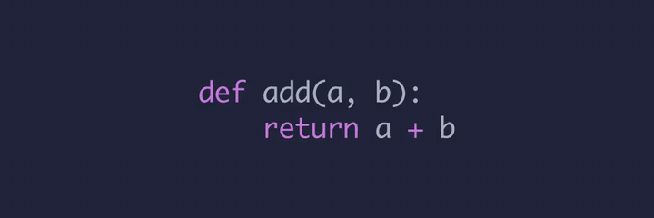
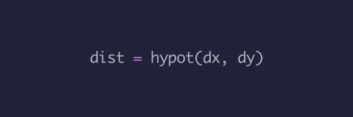
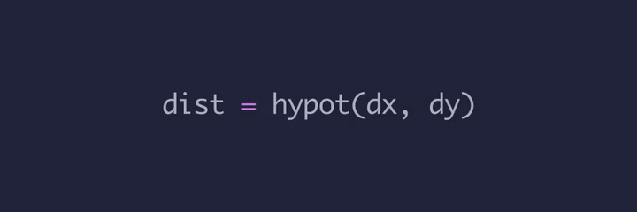
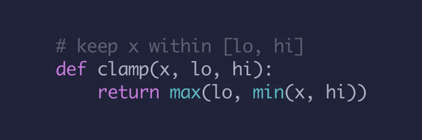
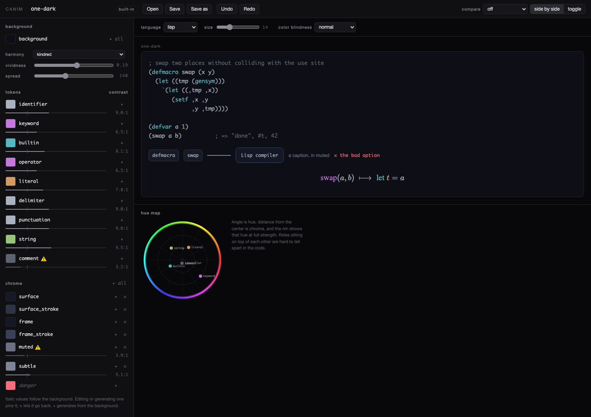

# canim

Code transformation animations for [manim](https://www.manim.community/).

Animates one block of code becoming another token by token, rather than by
text diff. A name that moves, moves. A name that appears twice in the result,
splits in two. A token with no counterpart fades.

```python
from manim import Scene
from canim import Code, CodeTransform, PYTHON, JAVASCRIPT

class Languages(Scene):
    def construct(self):
        before = Code("def add(a, b):\n    return a + b", PYTHON)
        after = Code("function add(a, b) {\n  return a + b;\n}", JAVASCRIPT)
        self.add(before)
        self.play(CodeTransform(before, after))
```



`add`, the parameters, and the body slide to their new places; `def` fades out
under `function` and the `:` under the `{`; the `;` and `}` arrive with no
counterpart. Nothing was said about which token is which — that is the
matcher. The two blocks are not even in the same language, which it also does
not need to be told.

Every GIF below is rendered from [`examples/readme.py`](examples/readme.py):

```sh
manim examples/readme.py -qm --format=gif -r 960,320 Languages
```

The snippets differ from that file in three ways, all of them presentation:
it sets a theme and a font size on every block, passes a `run_time`, and holds
a still frame at each end so the loop reads. Anything that changes *what
happens* is in the snippet.

## Install

    pip install -e .

Python 3.12 only. The upper bound is real: ManimPango 0.5.0 has no 3.13 wheel
and fails to build from source.

Contents:

- [canim](#canim)
  - [Install](#install)
  - [Code blocks](#code-blocks)
  - [Transforms](#transforms)
  - [When the guess is wrong: mapping](#when-the-guess-is-wrong-mapping)
  - [Naming tokens: refs](#naming-tokens-refs)
  - [Coloring and highlighting: selections](#coloring-and-highlighting-selections)
  - [Cloning](#cloning)
  - [Debugging a transform](#debugging-a-transform)
  - [Themes](#themes)
  - [The theme editor](#the-theme-editor)
    - [The panel, left to right](#the-panel-left-to-right)
    - [The stage](#the-stage)
    - [Warnings](#warnings)
    - [The hue map](#the-hue-map)
    - [Saving](#saving)
  - [How it works](#how-it-works)
    - [The color math](#the-color-math)
  - [Video color metadata](#video-color-metadata)
  - [Tests](#tests)
  - [License](#license)

---

## Code blocks

`Code` is a `VGroup`, so it positions and animates like anything else in
manim.

```python
from canim import Code, PYTHON, JAVASCRIPT, LISP

Code("def f(x): return x + 1", PYTHON)
Code("const f = (x) => x + 1", JAVASCRIPT)
```

`PYTHON`, `JAVASCRIPT` and `LISP` ship. The language may be a name instead:
`Code("...", "python")`, `"javascript"`, `"js"`, `"lisp"`.

**The language is required.** There is no default, because a block lexed as
the wrong language does not fail — it renders, colored and matched by another
language's rules, and nothing tells you. Also accepted: `font`, `font_size`,
`line_spacing`, `theme`.

```python
Code(source, PYTHON, font_size=28, theme=theme.MONOKAI)
```

Two blocks in a transform need not share a language, as the opening example
shows — the lexer belongs to the block, not to the animation.

## Transforms

`CodeTransform(source, dest)` — the scene should hold `source` beforehand and
will hold `dest` afterwards. You do not add `dest` yourself.

Naming the subexpressions — one real compiler pass, A-normal form:

```python
before = Code("result = f(g(x), h(x))", PYTHON)
after = Code("a = g(x)\nb = h(x)\nresult = f(a, b)", PYTHON)

self.add(before)
self.play(CodeTransform(before, after))
```


Three outcomes, and every token gets exactly one. `g`, `h` and both `x`s
**move** out of the nest onto their own lines; `f` and `result` **move** down
to the last one; the new names `a` and `b` **fade in**. Nothing fades out,
because nothing was thrown away. Everything else in this README is those three
outcomes, chosen differently.

No mapping, and none needed: each name occurs the same number of times on both
sides and in the same order.

Options:

| option | description |
|---|---|
| `path_arc` | curve the moving glyphs instead of sliding them straight |
| `lag` | stagger between glyphs, default `0.08`; `0` moves everything at once |

## When the guess is wrong: mapping

Matching is automatic. It goes wrong whenever a token's real counterpart is
not the one that shares its text and its position — because position among
same-text tokens is all the greedy layer has to go on.

Rewriting a C-style `for` as a `while` is a good place to see it. In
JavaScript this is an exact rewrite: the header holds an init, a test and an
increment, and the `while` form just puts each one where it runs.

```python
before = Code("for (let i = 0; i < n; i++) {\n  total += i\n}", JAVASCRIPT)
after = Code("let i = 0\nwhile (i < n) {\n  total += i\n  i++\n}", JAVASCRIPT)

# only so the two can be told apart on screen
before.select(before.nth("i", 2)).set_color(GOLD)   # the header's increment
before.select(before.nth("i", 3)).set_color(GREEN)  # the body's use

self.add(before)
self.play(CodeTransform(before, after, path_arc=0.7))
```



Follow the gold one. The increment's `i` should end up at the bottom of the
loop body, next to the `++` it belongs to — instead it flies into `total += i`,
and the green one, which was already sitting where it needed to be, is thrown
down to the increment. They swap.

Nothing appears, nothing disappears, and the final frame is exactly right.
That is the trap: the count is right, the picture is right, and only the routes
are wrong. `i` occurs four times on each side, but not in the same order —
source is init, test, increment, body; destination is init, test, body,
increment. The first two pair correctly and the last two cross:

```
source
--------------------------------
 11 'i'          -> 13       move    ← the increment, into the body
 12 '++'         -> 15       move    ← its `++`, correctly, without it
 17 'i'          -> 14       move    ← the body, out to the increment
```

Say which is which. The same two blocks, with a third argument to
`CodeTransform`:

```python
self.play(CodeTransform(before, after, [
    ([before.nth("i", 2)], [after.nth("i", 3)]),   # the increment
    ([before.nth("i", 3)], [after.nth("i", 2)]),   # the body
], path_arc=0.7))
```



Now the gold `i` rides down with its `++` and the green one stays put, which is
what the rewrite actually does to them.

Duplication is the other half of this. A token used more than once in the
result has no chance at all: only one of the copies can be the same-text
partner, and the rest fade in from nothing. Macro expansion is that case in its
purest form — every argument pasted into several places — and the mapping in
the macros video, `fun_pasted` in `2026/macros/main.py`, exists for exactly
that reason. It matters twice over there, because the name the macro
introduces is `tmp`: if the *caller* also has a `tmp`, the greedy layer will
happily pair the user's with the macro's. That is the hygiene bug the video is
about, and the mapping is what keeps the animation from telling the wrong story
about it.

Each side is a list of *refs*. Counts are counted in refs, not tokens, so a
multi-token ref is one thing. That is how splits and merges are written:

```python
# one token becomes two — it splits and both copies travel
before, after = Code("f(n)", PYTHON), Code("n * n", PYTHON)
CodeTransform(before, after, [(["n"], after.all("n"))])

# two become one — they merge
before, after = Code("x + x", PYTHON), Code("2 * x", PYTHON)
CodeTransform(before, after, [(before.all("x"), ["x"])])
```

Note which block each ref comes from: a `from` ref must name a token in the
source and a `to` ref one in the destination. Getting that backwards is
caught, not animated.

One side must be a single ref: `1 → 1` moves, `1 → n` splits, `n → 1` merges.
Anything else raises `MappingError`, because which source survives changes
where the others travel from and there is no safe default — write it as
separate entries.

A mapping entry is an assertion, and it is the only layer that raises. The two
automatic ones always have an answer, which is exactly why a wrong guess
renders silently.

## Naming tokens: refs

A bare string is the first token with that text. For anything else:

```python
code.nth("x", 1)           # the second `x`
code.all("x")              # every `x`, as a list of refs
code.nth("(", 0).partner   # the `)` that closes it
code.nth("min(x, hi)")     # several tokens as one ref
```

Resolution is token-level, never a substring search. In

```python
# keep x within [lo, hi]
def clamp(x, lo, hi):
    return max(lo, min(x, hi))
```

`code.all("x")` finds exactly two tokens. It does not find the `x` in the
comment, because a comment is one token whose text merely contains it, and it
would not find one inside a string literal or inside a longer name either. A
multi-token ref is matched against the token sequence, so it is found however
it happens to be line-broken on screen.

## Coloring and highlighting: selections

`code.select(refs)` gives the glyphs for those tokens as a `VGroup`, so
everything you already do in manim works:

```python
code = Code(
    "# keep x within [lo, hi]\n"
    "def clamp(x, lo, hi):\n"
    "    return max(lo, min(x, hi))",
    PYTHON,
)

# both `x` tokens — not the one in the comment
self.play(code.select(code.all("x")).animate.set_color(GOLD))

# a delimiter and the one that balances it
opener = code.nth("(", 0)
self.play(code.select([opener, opener.partner]).animate.set_color(RED))
```

For geometry rather than a tween, `.boxes()` draws a rectangle around each
contiguous run — and a multi-token ref is one run, so it gets one box:

```python
self.play(Create(code.select(code.nth("min(x, hi)")).boxes()))
```

All three in sequence:



The `x` in the comment staying gray is the token-level rule, visible.

Because a box is a real mobject over real glyphs, it can be attached to what
it marks and moved along with it, instead of being re-drawn every beat.

## Cloning

`code.clone()` is a second block identical to the first, *including anything
applied after construction* — scale, position, color. Add both, then transform
one while the other stays put, and the copy reads as having lifted off the
original.

```python
copy = code.clone()
self.add(copy)
self.play(copy.animate.shift(DOWN))
```

Rebuilding from the constructor arguments instead would lose those later
changes; a scaled block cloned itself back to full size and sat on top of the
original, doubled.

## Debugging a transform

**Look at the correspondence, not the render.** A wrong-but-valid
correspondence produces a perfectly correct final frame — the tokens just took
absurd routes to get there. Pixels prove nothing here.

```python
from canim import dump, match, PYTHON, JAVASCRIPT
from canim.lexer import lex

a = lex("def add(a, b):\n    return a + b", PYTHON)
b = lex("function add(a, b) {\n  return a + b;\n}", JAVASCRIPT)
print(dump(a, b, match(a, b)))
```

```
source                            destination
--------------------------------  --------------------------------
  0 'def'        -> ·        fade out         0 'function'   <- ·        fade in
  1 'add'        -> 1        move             1 'add'        <- 1        move
  2 '('          -> 2        move             2 '('          <- 2        move
  3 'a'          -> 3        move             3 'a'          <- 3        move
  4 ','          -> 4        move             4 ','          <- 4        move
  5 'b'          -> 5        move             5 'b'          <- 5        move
  6 ')'          -> 6        move             6 ')'          <- 6        move
  7 ':'          -> ·        fade out         7 '{'          <- ·        fade in
  8 'return'     -> 8        move             8 'return'     <- 8        move
  9 'a'          -> 9        move             9 'a'          <- 9        move
 10 '+'          -> 10       move            10 '+'          <- 10       move
 11 'b'          -> 11       move            11 'b'          <- 11       move
                                             12 ';'          <- ·        fade in
                                             13 '}'          <- ·        fade in

* = from the mapping;  · = no counterpart
```

This is the opening example, and the table is how you know it is right: the
second `a` went to the second `a`, not across to the first.

Read it in both directions. Most mapping bugs are one token flying somewhere
it has no business going, and this is the only way to see it. `*` marks what
your mapping asserted, so you can tell your intent from the matcher's guess.

For the same thing on screen, `correspondence_view` and
`correspondence_labels` draw both blocks with their links.

## Themes

A theme carries a color per token kind plus the non-syntax colors a scene
needs around them — panel fills, borders, de-emphasized text, a red for the
bad option. The non-syntax ones default to a value mixed out of the
background, so a new theme gets coherent chrome without naming seven more
hexes; a theme that cares can pin them.

Five ship with the library, as objects, so nothing needs a path:

```python
from canim import theme

theme.ONE_DARK
theme.ONE_DARK_SLATE      # theme.DEFAULT
theme.PASTEL_EVENING
theme.MONOKAI
theme.SOLARIZED_DARK

theme.BUILT_IN["monokai"]     # by name
```

Set one on a scene, and hand it to every block:

```python
THEME = theme.MONOKAI

class Themed(Scene):
    def construct(self):
        self.camera.background_color = THEME.background
        self.add(Code("def f(x): return x + 1", PYTHON, theme=THEME))
```

Your own themes live wherever you keep them, as flat `.theme.json`, loaded by
path:

```python
THEME = theme.open(Path(__file__).parent / "themes" / "marine.theme.json")
```

A bare name only ever means one of canim's five.

The format is flat. Every token role is required; chrome is not, and a file
records only the chrome it *pins* — writing a derived value back would freeze
it and stop it following the background. This is a complete, valid theme:

```json
{
  "name": "marine",
  "background": "#022c26",
  "identifier": "#e1f4ea",
  "keyword": "#28c8b3",
  "builtin": "#2edcff",
  "operator": "#e147c0",
  "literal": "#d4d638",
  "delimiter": "#e1f4ea",
  "punctuation": "#e1f4ea",
  "string": "#22d325",
  "comment": "#186d61",
  "chrome_surface": "#083f38"
}
```

Here `surface` is pinned to `#083f38` and the other six chrome colors are
mixed out of the background — `frame` comes out `#0d3630`. Change the
background and they follow; `surface` does not.

`theme.save(t, path)` writes one back. Files must end in `.theme.json`.

## The theme editor

    python -m canim.theme_editor

or `canim-theme-editor`. It opens a browser at <http://127.0.0.1:8765>. It is
a local server plus a page — nothing is uploaded, and it reads and writes only
files you point it at.



The interface is achromatic on purpose. You cannot judge a palette inside a
colored one — any hue in the chrome sits next to the swatches and
contaminates the comparison — so every pixel of it is a neutral gray and the
only color on screen is the theme being edited. Even the warnings signal with
a ⚠️ glyph rather than an accent color.

```
--port 8765           what to listen on
--no-open             do not open a browser
--themes <dir> ...    directories of your own themes to list alongside canim's
                      (default: ./themes)
```

Run it from the directory whose `themes/` you want listed, or name them:

```sh
canim-theme-editor --themes ~/videos/themes ~/other/themes
```

### The panel, left to right

**background** — the color everything else is judged against. Its `✦ all`
button generates a whole palette from it: every token role *and* the chrome.
Three knobs shape what it produces:

- **harmony** — `kindred` centers the fan of accents on the background's own
  hue, so one role lands right on it. That is what makes a theme read as being
  *about* a color. `opposite` puts them on the far side of the wheel, so
  nothing goes flat against the background — safer, and what One Dark does.
- **vividness** — chroma of the generated accents.
- **spread** — how wide a hue arc they fan across.

**tokens** — one row per role. Each row has a swatch, the role name, a `✦` to
generate just that role from the background, and a contrast reading on the
right with a tick at 4.5:1. Click a swatch for a picker that also takes hex.

**chrome** — panel fills, borders, muted and subtle text, danger. Values in
*italic* are following the background rather than being set. Editing or
generating one pins it; `×` lets it go back. `✦ all` in the heading
regenerates all seven.

### The stage

Your palette on real code, lexed by canim itself rather than by a copy of the
lexer living in the page — so what you see is what a render produces. Type
your own code into it. `language` switches lexers, `size` scales everything,
and `color blindness` re-renders the whole preview through a simulation of
protanopia, deuteranopia or tritanopia. Below the code sits a strip of chrome
elements and a KaTeX formula, so the non-syntax colors get judged too.

**compare** puts a second theme beside yours, either side by side or as a
toggle — with `toggle`, press <kbd>space</kbd> to flip between them, which
catches differences that side-by-side hides.

### Warnings

A ⚠️ next to a color means one of two things, and hovering says which:

- **contrast** — against the background, so: can you read it at all.
- **separation** — against another token color, so: can you tell a comment
  from a keyword.

These are different questions and a color can pass one and fail the other.
Roles that conventionally share a color (keyword/operator,
identifier/delimiter) are not reported.

### The hue map

Every color plotted by hue (angle) and chroma (distance from center), with the
rim showing each hue at full strength. Roles sitting on top of each other
there are the ones that will be hard to tell apart in code.

### Saving

`Save` (<kbd>⌘S</kbd>) writes back to the file you opened. `Save as` opens a
real file dialog. `Open` lists canim's five under **canim** and everything in
your `--themes` directories under **yours**, plus a `Browse files…` button for
anything else.

Saving one of canim's own is diverted to Save As, defaulting to a name like
`one-dark custom` — editing `one-dark` in the editor must not change what
every video that imports it renders as.

Undo and redo are <kbd>⌘Z</kbd> and <kbd>⇧⌘Z</kbd>, and last as long as the
tab. Closing with unsaved changes prompts first.

## How it works

Lex, match, animate.

**Glyph identity.** A `Code` block is one manim `Text` holding the whole
source. Manim emits one submobject per character, whitespace included, so a
token's character offset *is* its glyph index and a run of tokens is always a
contiguous glyph range. The constructor asserts this; if a font ever breaks
the assumption, everything downstream silently colors and animates the wrong
glyphs.

**Lexing is stateless.** A token's kind is a pure function of its own text —
no lookbehind, no parser state — so colors cannot flicker on the intermediate
frames of a transform, which are usually valid in no language at all. The cost
is that a name being *defined* cannot be told from one being *used*.

**Matching is three layers**, each seeing only what the previous did not
claim: the hand-written mapping, then greedy same-text pairing in source order
with delimiter partners forced, then fade. Only the mapping raises — it is an
assertion, while the other two always have an answer.

**Glyph pairing is done here, not handed to manim.** `Transform` on two
VGroups calls `align_data`, which pads the shorter side by duplicating
submobjects, and that renders as a smear. Since the correspondence is already
known exactly, canim pairs explicitly and lets a length mismatch degrade to a
fade.

### The color math

`palette.py`, pure functions over hex strings.

**OKLCH, not HSL.** HSL's lightness is not perceptual — `#1aff47` and
`#0000ff` are both "50%" and one is blinding beside the other. Picking a
palette in HSL turns into hunting a lightness per hue; in OKLCH one lightness
reads as one brightness across the wheel.

**Contrast and separation are different questions**, as above.

**Separation scores three axes and takes the best.** Colors differ by
lightness, by how colorful they are, or by hue, and any one is enough on its
own. A single distance metric cannot do this — One Dark's identifier/builtin
and marine's keyword/builtin have nearly identical chroma *distance* and
opposite verdicts, because a near-gray beside a cyan is obvious while two
equally-saturated teals are not. Hue only counts when both colors have enough
chroma to show one. The calibration table is in the docstring; if a real pair
is ever judged wrong, add it there and re-derive the thresholds rather than
nudging a number.

## Video color metadata

Manim writes H.264 with no color metadata, so every player guesses. QuickTime
guesses BT.709 with a video transfer curve and color-manages to the display,
which is why a render looks brighter and more saturated than the same hex does
in a browser. That is the file's silence, not a rendering bug. Call this once
from a video's module and it stops:

```python
from canim.video import tag_color_space
tag_color_space()
```

**The correct tags are BT.601, not BT.709** — manim's RGB→YUV conversion uses
601 coefficients even at 720p. Established by tagging a real render three ways
and measuring how far the decode drifted from the source colors:

| matrix | | total error across four colors |
|---|---|---|
| 1 | bt709 | 42 |
| 5 | bt470bg | 4 |
| 6 | smpte170m | 4 |

So the stream is tagged `smpte170m` for the matrix, with sRGB primaries and
transfer for the RGB it was converted from. Tagging BT.709 — the obvious guess
for HD — makes the colors *worse*. Tagging only changes what the file
declares, not what is encoded.

To check a file:

```sh
ffprobe -v error -select_streams v:0 \
  -show_entries stream=color_range,color_space,color_transfer,color_primaries \
  -of csv=p=0 out.mp4
```

## Tests

    pytest canim

## License

MIT.
